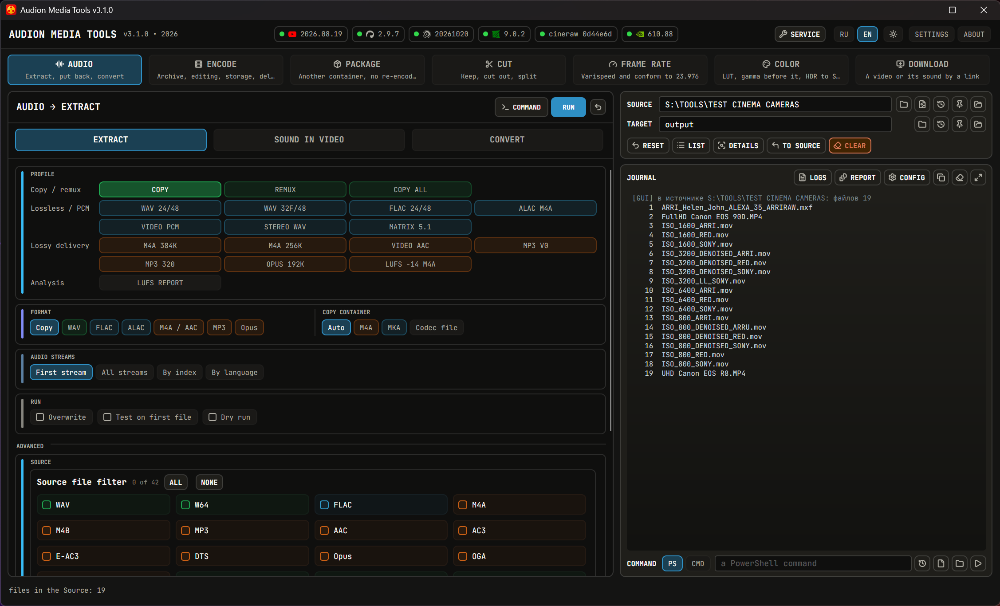

# Audion Media Tools

<!-- audion:release -->
<p align="center">
  <a href="https://audion.dev/downloads/media-tools"></a>
  <a href="https://github.com/Tensionix/media-tools/releases/latest"></a>
  <a href="https://github.com/Tensionix/media-tools/releases"></a>
  <a href="https://github.com/Tensionix/media-tools/blob/main/LICENSE"></a>
</p>

**Version 3.1.0** · 2026-10-20 · 571.4 MB

- [Direct download](https://dl.audion.dev/media-tools/3.1.0/Audion_Media_Tools_v3.1.0_Full.zip) — unmetered, no rate limits
- [Project page](https://audion.dev/downloads/media-tools) — every version and how to install
- [GitHub release](https://github.com/Tensionix/media-tools/releases/tag/v3.1.0)

<p align="center"></p>

`SHA-256: 9376e49dd9a9beb0d6ff990ebc4b31c80376401d877f6cb4db18974c9ddf9d6b`

---

An **Audion** tool, published by [Tensionix](https://github.com/Tensionix).
<!-- /audion:release -->


[English README](Docs/README_EN.md) · [User Guide](Docs/USER_GUIDE_EN.md) | [Русский README](Docs/README_RU.md) · [Руководство](Docs/USER_GUIDE_RU.md)

[Console command](Docs/CLI_EN.md) · [Measurements](Docs/MEASUREMENTS_RU.md) · [Decisions](Docs/DECISIONS_EN.md)

**Contents**

- [Why It Exists](#why-it-exists)
- [The Central Decision: Newer Is Not Better](#the-central-decision-newer-is-not-better)
  - [What each path can do](#what-each-path-can-do)
- [Why You Can Trust This](#why-you-can-trust-this)
  - [Where this started](#where-this-started)
  - [Verified on what cameras actually write](#verified-on-what-cameras-actually-write)
  - [Sync measured, not assumed](#sync-measured-not-assumed)
  - [Seventeen FFmpeg quirks — all compensated](#seventeen-ffmpeg-quirks--all-compensated)
- [Principles](#principles)
- [What Is Inside](#what-is-inside)
- [Next](#next)
- [Technical Reference](#technical-reference)
  - [Running](#running)
  - [Folders](#folders)
  - [Defaults](#defaults)
  - [Reports](#reports)
  - [Before the Run](#before-the-run)
  - [What to Check After a Run](#what-to-check-after-a-run)
  - [Deliberately Out of Scope](#deliberately-out-of-scope)

A portable program for real work with video and sound: download, inspect,
transcode, prepare for editing, package for upload, put into an archive, take
sound apart carefully, cut camera files without loss.

## Why It Exists

FFmpeg does all of this — and that is the problem. The right command for an
editing codec, for an archival master, and for an upload all look different, run
to a line and a half of flags, and half those flags are learned the hard way: the
container will not hold that stream, picking a channel flipped the byte order in
the audio, the camera metadata was lost in the remux.

This program keeps that experience in presets and gives it a window: sections
and modes, presets, remembered paths, a terminal with FFmpeg's own output, and the
visible command. Every button of the window is an operation of the console
command `media_cli.cmd`, so the same work runs from a batch file or by an AI agent
asked in plain words.

## The Central Decision: Newer Is Not Better

Every FFmpeg build is compiled against a particular version of the NVIDIA
hardware-encoding headers, and each one demands its own minimum driver. Install
the newest build on an older driver and hardware encoding does not get faster —
it stops working.

| FFmpeg build | NVENC headers | NVIDIA driver required |
|---|---|---|
| 9.0.1 | n13.1.15.0 | **610.0** |
| 8.0.1 | n13.0.19.0 | **570.0** |
| 7.1.1 | n13.0.19.0 | **570.0** |
| 7.1 | n12.2.72.0 | 551.76 |

The third row matters most: 7.1.1 was built with the same headers as 8.0.1 and
needs the same 570.0 — "rolling back one version" on an older driver gains
nothing. Only 7.1 helps.

So the installer picks a build to match your driver rather than taking the latest.

**8.0.1 ships by default** — a choice, not a forgotten update. Editing machines
today mostly run drivers somewhere between 571 and 609; the 610 branch is on very
few. Both 8.1 and 9.x require it: shipping them would mean advertising NVIDIA
acceleration and denying it to most of the people promised it. 8.0.1 has
everything these programs use and runs on the drivers people actually have.

With no NVIDIA card none of this matters: encoding runs on the processor.

### What each path can do

All three hardware paths are supported equally fully: NVIDIA, Intel, and AMD each
cover H.264, HEVC, and AV1, with their own native quality controls and their own
decode probes. The differences in the table below are limits of the encoders
themselves, not gaps in the program.

| path | H.264 | HEVC | AV1 | 10-bit | 4:2:2 |
|---|---|---|---|---|---|
| CPU (x264 / x265 / SVT-AV1) | yes | yes | yes | yes | yes |
| NVIDIA NVENC | 8-bit | yes | `av1_nvenc` | HEVC and AV1 | newer hardware only |
| Intel QuickSync | 8-bit | yes | `av1_qsv` | HEVC and AV1 | no |
| AMD AMF | 8-bit | yes | `av1_amf` | HEVC and AV1 | no |

**H.264 on any hardware path is 8-bit only.** If you need 10, use HEVC, AV1, or
x264 on the processor.

Decoding is a separate stack: on a machine without hardware encoding, hardware
decoding may work perfectly well. It is checked by its own probes: `CUDA decode`,
`QuickSync decode`, `AMD/D3D11VA decode`, and `dav1d` for AV1.

Quality controls always belong to the path: `CRF` and the SVT-AV1 preset on the
processor, `CQ/QP` and the NVENC, QuickSync, or AMF presets on hardware. Only x264
and x265 read the fine-tuning list, which is why it appears solely when the
processor is selected.

**Run SERVICE → Hardware capabilities before the first run on a new machine.** The
result is cached and the profiles are checked against it. A missing path is a
normal answer, not a fault: it means the driver or the hardware is absent. The
cache belongs to the machine — if it is from another one or missing, run the
check again. SETTINGS shows what passed, next to the processor, the video card and
its driver.

## Why You Can Trust This

Cut accuracy, audio sync, and the limits of FFmpeg here are not claimed — they are
measured. The [body of measurements](Docs/MEASUREMENTS_RU.md) rests on one rule:
**nothing in it is taken from documentation.** Every cell in every table is an
actual attempt, every number a measurement. Where a measurement turned out to be
wrong, that is recorded too: a separate section collects the cases where a
plausible conclusion had to be withdrawn.

### Where this started

Since version 19.1 Shutter Encoder reads a fractional rate as an integer: 29.97
becomes 30. The 1.001 error accumulates — 1.8 seconds of drift per half hour,
four seconds per hour. It is still there in 20.2, and issue
[#402](https://github.com/paulpacifico/shutter-encoder/issues/402) remains open.

Here the count runs on an exact fraction:

| rate | fraction | request | correct | via `round(fps)` |
|---|---|---|---|---|
| 23.976 | 24000/1001 | 50 s | **1199** | 1200 |
| 29.97 | 30000/1001 | 4 min | **7193** | 7200 |
| 59.94 | 60000/1001 | 4 min | **14386** | 14400 |

The quantities at stake: a frame is 33 ms at 29.97, an audio packet 8 ms, a sample
20 microseconds. A one-frame shift is what an editor later hunts for by hand.

### Verified on what cameras actually write

Not on generated clips — on footage from real bodies, from Sony to ARRI. The frame
discrepancy is zero throughout:

| source | request | frames | discrepancy |
|---|---|---|---|
| ProRes 25p | 3 → 9 | 150 | 0 |
| HEVC long-GOP 29.97 | 12 → 30 | 600 | 0 |
| H.264 all-intra 23.976 | 3 → 9 | 144 | 0 |
| 29.97 drop-frame | 5 → 15 | 330 | 0 |
| 59.94 drop-frame | 3 → 9 | 360 | 0 |
| MPEG-TS starting at 1.44 s | 2 → 8 | 300 | 0 |
| 4 channels of PCM | 2 → 8 | 150 | 0 |
| Canon HEVC 4:2:2 10-bit | 3 → 10 | 166 | 0 |
| ARRI ProRes 4444 XQ 24.000 | 2 → 8 | 144 | 0 |

One finding stands out: an Alexa Mini shooting a true 24.000 declares `24/1` — so
reading that file as 23.976 **creates** the 1.001 error rather than removing it.
Five frames over four minutes, exactly what other tools are criticised for. The
rate is taken from the file as written; one that cannot be read is refused rather
than replaced with a guess.

### Sync measured, not assumed

A marker present in both streams at the same instant: a white frame at the top of
every second and a 20 ms click at the same moment. Deviation from the source's own
offset:

| container | change |
|---|---|
| MP4 | 0…2 ms |
| MOV | 0…5 ms |
| MKV | 1…3 ms |
| MXF | 9…18 ms |

Only MXF shifts anything — its muxer aligns audio to its own edit units, under
half a frame, and that is stated as a warning. An earlier warning about MKV was
disproved by precise measurement and removed rather than left in as a
plausible-sounding caution.

### Seventeen FFmpeg quirks — all compensated

None of them is obvious from the documentation, each cost a separate
investigation, and each is worked around in code. Among them: `-ss` before `-i`
resets the clock; an end point rounded "to nearest" loses the frame sitting at
29.9966; HEVC with a B-pyramid writes two to four frames fewer than asked;
`avg_frame_rate` on variable frame rate turns a 12-second request into 16; `-n` on
an existing file answers "already exists" with **exit code 0**, so a run that
wrote nothing reads as a success; PCM copied into MXF gains 384 extra samples at
the head.

The full list with symptoms is in the [measurements](Docs/MEASUREMENTS_RU.md),
section 10. The [checklist](Docs/SMOKE_TEST_RU.md) shows what is run before a release.
Both documents are in Russian.

## Principles

**Verified on a real file, not a synthetic one.** A generated clip carries neither
camera tags nor big-endian audio — and those are exactly what two defects hid
behind. The verification matrix is built on footage from actual cameras.

**A mode is named by what survives.** "Keep", "Cut out", "Split" — a list of what
will be in the result reads unambiguously; a list of exclusions does not.

**What the container cannot hold is refused before the run, not halfway through.**
An incompatible codec and container pairing is blocked in the form and checked
again by the service.

**A stopped run leaves nothing that cannot be opened.** A file is written under a
name of its own and takes its real name only whole; an unfinished file does not
pretend to be ready.

**An operation never changes the Source.** The result goes to the Target; the
files of the Source stay as they were.

**Results go into an operation folder, not into the filename.**
`input\Day1\clip.mov` and `input\Day2\clip.mov` do not collapse into one flat
folder and fight over a name: the subfolder structure is reproduced in the output.

## What Is Inside

The ribbon of the window, each section with its modes:

| section | modes | about |
|---|---|---|
| AUDIO | extract · sound in video · convert | sound out of a video, converted inside a video with the picture copied, sound files converted; resampling, loudness to LUFS, channels |
| ENCODE | archive · editing · storage · delivery | FFV1 and lossless x264; ProRes and DNxHR in MOV or MXF; x264, x265, SVT-AV1; review and upload |
| PACKAGE | video · audio · video and audio · subtitles | another container without re-encoding; orientation of a camera turned on its side; subtitle streams out |
| CUT | keep · cut out · split | frame-accurate cuts of camera files without loss; several variants from one take, a split at up to 30 points; sound without loss (WAV, FLAC, ALAC) on the sample, compressed sound on its packets without re-encoding, or on the sample with Exact |
| FRAME RATE | varispeed · conform | to 23.976 and the whole working range |
| COLOR | LUT | a LUT with a gamma before it; HDR to SDR |
| DOWNLOAD | best MP4 · safe MP4 · own video · for upload · own audio · subtitles | a link, a playlist or a list of links by yt-dlp |

DETAILS tells what the files of the Source are (ffprobe). SERVICE holds the checks
and the installers: inventory, self-test, profile check, hardware capabilities,
the preset test matrix, installing 7-Zip, FFmpeg, yt-dlp and mpv.

## Next

* [User Guide](Docs/USER_GUIDE_EN.md) — the window, the order of work, cutting with the
  player, reports.
* [Console command](Docs/CLI_EN.md) — `media_cli.cmd`: every operation from a console
  or a script.
* [Operations](Docs/OPERATIONS_EN.md) — every field, choice and preset;
  [Wrappers](Docs/SCRIPTS_EN.md) — the 95 ready tasks of `Scripts\`.
* [AI agent](Docs/AI_AGENT_GUIDE_EN.md) — for Claude Code, Codex and the like.
* [Measurements](Docs/MEASUREMENTS_RU.md) — the numbers everything rests on.
* [Checklist](Docs/SMOKE_TEST_RU.md) — what is run before a release.
* [Decisions](Docs/DECISIONS_EN.md) — why it works this way, dated and verified.
* [Changelog](Docs/CHANGELOG_EN.md) — what each version brought.

---

## Technical Reference

### Running

`Start.exe` in the root of the program opens the window. Nothing is installed:
the window, its PowerShell, Python, FFmpeg, yt-dlp, mpv and 7-Zip all live in the
program folder.

If the Python environment or a tool is missing, `builder_main.cmd` builds it: a
menu with the environment, the checks and an installer for each tool (FFmpeg,
yt-dlp with Deno, mpv, 7-Zip). Every installer names its files, their source and
their size before it downloads.

### Folders

| folder | what it holds |
|---|---|
| `input\` | the Source by default: the files to work on; `input\urls.txt` — a list of links |
| `output\` | the Target by default: every result, in a folder of its operation |
| `LUTs\` | the LUTs of COLOR (`.cube`, `.3dl`, `.lut`) |
| `logs\`, `report\` | the journal of every run, its report |
| `Scripts\` | 95 ready tasks — wrappers of the console command |

The Source is walked recursively and the subfolder structure is preserved in the
output. Results are written into an operation and profile folder:

```
output\Remux\remux_mkv_to_mp4_video_audio\Day1\clip.mp4
```

Another Target simply replaces `output`; the internal structure stays the same.
Downloads go to `output\Download`.

### Defaults

| what | value |
|---|---|
| quality (CRF/CQ) | 14 |
| audio | 384 kbps; M4A has a 256 profile |
| resampler | SoX/libsoxr at full quality (`precision=33`) |
| download archive | off |
| overwriting | off |

Pixel format is not chosen in EDITING — the target defines it: ProRes is always
10-bit 4:2:2, DNxHR HQ is 8-bit, DNxHR HQX is 10-bit. To change bit depth you pick
a different target, not a separate field.

MXF offers 16- or 24-bit PCM or no audio at all; incompatible choices are blocked
in the form and checked by the service. FLAC is unavailable for MOV — that
container does not hold it; use MP4 or MKV.

### Reports

Every run writes its journal to `logs\` and `batch_report.md` with `.json` to
`report\`. AUDIO adds `audio_report.md` and `.json`: the source stream, input
parameters, processing mode, loudness, and the output path.

### Before the Run

Every media operation checks itself before FFmpeg or yt-dlp starts: the Source
exists, the Target exists or can be made, files of the operation's kind are found,
the chosen LUT exists, the repackaging target can hold the streams, the encoder is
in this FFmpeg, the hardware path passed the hardware check. What fails is said in
`[PREFLIGHT]` lines, and nothing is run. The check does not replace attention, but
it stops the most expensive mistakes before the first frame.

### What to Check After a Run

A finished run is not yet an accepted result. What each kind of work asks to be
looked at:

| work | look at |
|---|---|
| archive | the size before a large run; keep checksums; test decoding from the final storage, not only from the working disk |
| editing | the frame rate, pixel format, field order, audio sample format and timecode in the editor that will take the files |
| storage, delivery | the defaults are starting points: try difficult motion, grain, gradients, subtitles and audio peaks on a short clip, on the player or platform it is meant for; a hardware encoder may look different from the processor |
| package | every file is probed, not judged by its extension; what a container cannot hold is skipped with the reason. Orientation is written into the container — the display matrix an editor reads — and nothing is re-encoded: a 960x540 file keeps its bytes and a decoder returns 540x960. MP4, MOV and MKV store it, MXF does not |
| frame rate | duration, timestamps, sync, the frame count and the cadence on motion — not the target number alone; a folder of mixed rates is better split |
| color | the LUT chosen and its version; range, transfer, primaries, matrix, clipping and neutral balance in a colour-managed viewer. The 18% grey preview shows the direction of the gamma, not a proof. A LUT path with spaces, apostrophes, commas or brackets is escaped for FFmpeg by the program |
| sound | the stream chosen — by language, layout and codec, not by its number; PCM and FLAC are safer in MOV or MKV than in MP4; sync, duration and loudness after the run |
| download | the list of links before a batch; failed links one by one — access, sign-in, a missing format and the network each need another remedy |

Hardware encoders take the pixel format in their own form (`yuv420p10le` becomes
`p010le`, QuickSync takes `nv12` for `yuv420p`); what an encoder cannot write —
10-bit H.264 on hardware — is refused before the run, not written in another
format.

Silence of a run is not a hang: the progress line, the growth of the file and the
journal tell more. One window runs one operation at a time; two copies of the
program may run side by side, but they share the processor, the video card and the
disk, and must not write the same file.

### Deliberately Out of Scope

The program does not try to replace an editor such as DaVinci Resolve or Premiere,
to be a universal builder of FFmpeg commands, to guess creative decisions, to hide
the risk of overwriting, or to keep probing large folders with ffprobe. Its
strength is media procedures that are safe, repeatable and clear.

WebM is currently an input, download, and remux format — not a separate target for
bulk encoding. If a VP9 or AV1 delivery in WebM is needed, it is better added as
its own profile with explicit quality, container, and audio parameters than bolted
onto the existing ones.
